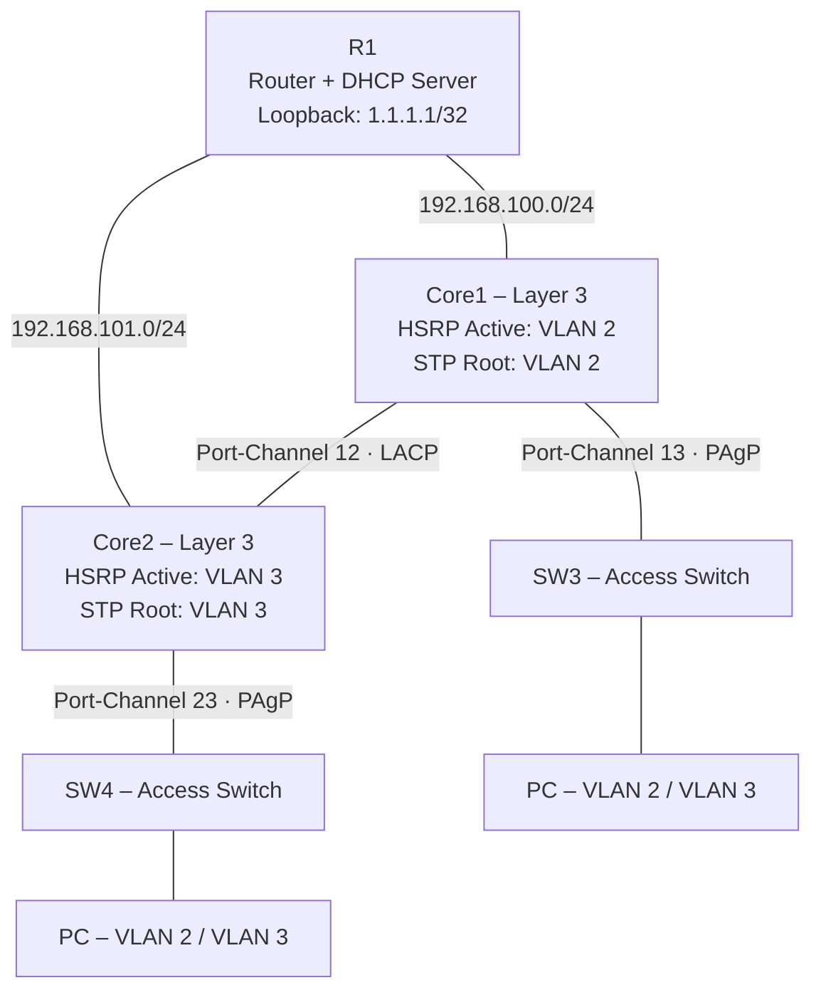

# Cisco Campus Network – Lab dự phòng HSRP, EtherChannel và STP

> **Mục tiêu dự án:** Xây dựng một hệ thống mạng campus thu nhỏ có khả năng dự phòng ở cả lớp 2 và lớp 3, duy trì kết nối khi đường uplink gặp sự cố và tự động chuyển đổi thiết bị gateway bằng HSRP kết hợp IP SLA/Tracking.
>
> **Trạng thái:** Đã hoàn tất cấu hình, xử lý sự cố và kiểm thử chức năng trong môi trường lab.

## 1. Tổng quan dự án

Lab mô phỏng mạng nội bộ sử dụng **hai switch Layer 3 làm Core**, **hai switch Layer 2 làm Access** và **một router kết nối phía trên**, đồng thời đóng vai trò DHCP Server. Các VLAN người dùng được cấu hình dự phòng gateway và có đường truyền thay thế khi xảy ra lỗi trên mạng.

Các nội dung thực hành chính:

- Thiết kế VLAN, trunk và định tuyến giữa các VLAN (**Inter-VLAN Routing**).
- Cấu hình **HSRP** để dự phòng default gateway, chia vai trò Active/Standby giữa hai Core.
- Kết hợp **IP SLA + Object Tracking** với HSRP để nhận biết lỗi đường truyền và giảm priority tự động.
- Sử dụng **EtherChannel với LACP và PAgP** để gộp các đường kết nối vật lý.
- Cấu hình **Spanning Tree Protocol (STP)** để ngăn loop Layer 2 và điều khiển đường chuyển tiếp.
- Cấp phát địa chỉ động bằng **DHCP Server và DHCP Relay**.
- Triển khai **Static Route, Floating Static Route và Track** để dự phòng đường định tuyến.
- Kiểm thử, phân tích và khắc phục lỗi khi chuyển đổi đường truyền (failover).

## 2. Mô hình mạng



*Đây là sơ đồ logic rút gọn nhằm làm rõ các thiết bị và các kết nối EtherChannel chính; không thể hiện toàn bộ cổng trunk và đường cáp vật lý của topology gốc.*

### Chức năng của từng thiết bị

| Thiết bị | Vai trò | Nhiệm vụ |
|---|---|---|
| **R1** | Router / DHCP Server | Cấp DHCP, định tuyến tĩnh dự phòng, IP SLA/Track, Loopback kiểm tra kết nối |
| **Core1** | Switch Layer 3 | Inter-VLAN Routing, HSRP Active VLAN 2, STP Root VLAN 2, IP SLA/Track |
| **Core2** | Switch Layer 3 | Inter-VLAN Routing, HSRP Active VLAN 3, STP Root VLAN 3, IP SLA/Track |
| **SW3** | Switch Layer 2 | Kết nối thiết bị đầu cuối, trunk, PAgP EtherChannel |
| **SW4** | Switch Layer 2 | Kết nối thiết bị đầu cuối, trunk, PAgP EtherChannel, tinh chỉnh STP cost |

## 3. Bảng địa chỉ IP

| Mạng / VLAN | Network | Core1 | Core2 | Gateway ảo HSRP | Thiết bị Active ưu tiên |
|---|---|---|---|---|---|
| VLAN 2 | `192.168.2.0/24` | `192.168.2.1` | `192.168.2.2` | `192.168.2.254` | **Core1** |
| VLAN 3 | `192.168.3.0/24` | `192.168.3.2` | `192.168.3.1` | `192.168.3.254` | **Core2** |
| Uplink R1 – Core1 | `192.168.100.0/24` | `192.168.100.2` | — | — | — |
| Uplink R1 – Core2 | `192.168.101.0/24` | — | `192.168.101.2` | — | — |

**Router R1:** `e0/0 = 192.168.100.1/24`, `e0/1 = 192.168.101.1/24`; `Loopback0 = 1.1.1.1/32`.

Các máy tính VLAN 2 và VLAN 3 sử dụng địa chỉ gateway ảo `.254`, thay vì trỏ trực tiếp đến địa chỉ IP vật lý của một Core.

## 4. Các công nghệ đã triển khai

### 4.1. HSRP – Dự phòng Default Gateway

- **VLAN 2:** Core1 được cấu hình priority `110` và ưu tiên giữ vai trò **Active**; Core2 là **Standby**.
- **VLAN 3:** Core2 được cấu hình priority `110` và ưu tiên giữ vai trò **Active**; Core1 là **Standby**.
- Cấu hình `preempt` để thiết bị ưu tiên có thể lấy lại vai trò Active khi điều kiện mạng phục hồi.
- Mỗi VLAN sử dụng **HSRP Virtual IP** làm default gateway cho PC.

### 4.2. IP SLA và Object Tracking

- Trên **Core1**, IP SLA kiểm tra khả năng truy cập uplink đến `192.168.100.1` và được liên kết với HSRP của VLAN 2.
- Trên **Core2**, IP SLA kiểm tra uplink đến `192.168.101.1` và được liên kết với HSRP của VLAN 3.
- Khi đối tượng Track chuyển sang **Down**, HSRP priority của Core tương ứng giảm **20** điểm, tạo điều kiện chuyển vai trò Active sang Core còn lại.
- Khi đường truyền hoạt động lại, Track trở về **Up** và HSRP có thể khôi phục vai trò Active theo priority và `preempt`.

### 4.3. EtherChannel – LACP và PAgP

| Kết nối | Port-Channel | Giao thức | Mục đích |
|---|---|---|---|
| Core1 ↔ Core2 | `Po12` | **LACP** | Gộp đường truyền giữa hai Core |
| Core1 ↔ SW3 | `Po13` | **PAgP** | Gộp đường uplink từ Access lên Core1 |
| Core2 ↔ SW4 | `Po23` | **PAgP** | Gộp đường uplink từ Access lên Core2 |

EtherChannel giúp các liên kết vật lý cùng nhóm được quản lý như một interface logic, hỗ trợ tăng băng thông tổng hợp và dự phòng khi một member link bị mất (nếu vẫn còn member hoạt động).

### 4.4. STP – Chống loop và tối ưu đường truyền

- **Core1** được đặt làm **Root Bridge ưu tiên cho VLAN 2**.
- **Core2** được đặt làm **Root Bridge ưu tiên cho VLAN 3**.
- Có điều chỉnh STP cost trên `Po23` của SW4 đối với VLAN 2 nhằm tác động đến việc lựa chọn đường truyền.
- STP bảo đảm topology Layer 2 không tạo vòng lặp khi tồn tại các kết nối dự phòng.

### 4.5. DHCP Server và DHCP Relay

- **R1** cấp địa chỉ động cho `192.168.2.0/24` và `192.168.3.0/24`.
- Trên các SVI, lệnh `ip helper-address` chuyển tiếp yêu cầu DHCP của PC về R1.
- Default gateway cấp cho PC lần lượt là `192.168.2.254` và `192.168.3.254`.

### 4.6. Static Route, Floating Static Route và Tracking

- Các Core có route đến Loopback `1.1.1.1/32` của R1 qua uplink tương ứng.
- R1 có đường định tuyến chính đến VLAN 2 qua **Core1** và VLAN 3 qua **Core2**.
- Các route dự phòng có **Administrative Distance lớn hơn**.
- IP SLA/Track trên R1 hỗ trợ loại bỏ route chính không còn đáp ứng điều kiện kiểm tra, cho phép route dự phòng được lựa chọn.

## 5. Nguyên lý hoạt động và chuyển đổi dự phòng

**Trạng thái bình thường**

1. PC nhận địa chỉ IP qua DHCP và dùng HSRP Virtual IP làm gateway.
2. Core1 xử lý vai trò gateway Active cho VLAN 2; Core2 đảm nhiệm VLAN 3.
3. STP xác định đường chuyển tiếp Layer 2; EtherChannel duy trì các nhóm liên kết trunk.
4. R1 sử dụng đường định tuyến chính đến từng VLAN.

**Khi uplink chính gặp sự cố**

1. IP SLA phát hiện đích kiểm tra không còn truy cập được và cập nhật Track thành **Down**.
2. Priority của HSRP trên Core bị ảnh hưởng giảm; Core còn lại có thể trở thành **Active**.
3. Route chính có Track trên R1 không còn hợp lệ, route dự phòng được sử dụng.
4. Trunk, EtherChannel và STP cung cấp đường chuyển tiếp Layer 2 thích hợp để lưu lượng tiếp tục đi qua Core còn hoạt động.
5. Khi kết nối phục hồi, Track trở về **Up**; HSRP `preempt` và các tuyến được đánh giá lại theo cấu hình.

> **Lưu ý kỹ thuật:** HSRP chuyển Active thành công chưa đủ để kết luận mạng đã dự phòng hoàn chỉnh. Cần kiểm tra đồng thời đường đi Layer 2, route chiều đi/chiều về và khả năng ping từ PC đến đích.

## 6. Kiểm thử và xác minh

Lab đã được hoàn thành và xử lý các lỗi gặp phải trong quá trình cấu hình, bao gồm việc kiểm tra trạng thái Track, thay đổi HSRP priority và kết nối của PC sau khi chuyển gateway Active.

| Hạng mục kiểm thử | Kết quả |
|---|---|
| DHCP cấp IP đúng subnet, đúng default gateway cho các PC | **Đạt** |
| HSRP Active/Standby đúng theo VLAN khi hoạt động bình thường | **Đạt** |
| IP SLA/Track thay đổi trạng thái **Up/Down** khi uplink thay đổi | **Đạt** |
| HSRP priority tự động giảm và phục hồi theo Track | **Đạt** |
| HSRP chuyển đổi gateway Active khi có sự cố | **Đạt** |
| Route trên R1 chuyển sang đường dự phòng khi cần | **Đạt** |
| PC khôi phục khả năng ping sau khi failover | **Đạt** |
| Kiểm tra các kết nối EtherChannel và vai trò STP | **Đạt** |

*Kết quả trên phản ánh trạng thái hoàn tất lab do người thực hiện xác nhận. Chưa ghi nhận số liệu định lượng về thời gian hội tụ hoặc tỷ lệ mất gói nên không đưa ra cam kết “zero downtime”.*

### Các lệnh kiểm tra sử dụng

```cisco
show standby brief
show track
show ip sla statistics
show etherchannel summary
show spanning-tree vlan 2
show spanning-tree vlan 3
show interfaces trunk
show ip route
show ip interface brief
show ip dhcp binding
```

### Quy trình kiểm thử failover

1. Kiểm tra trạng thái ban đầu bằng `show standby brief`, `show track`, `show ip route`.
2. Ping từ PC đến **HSRP Virtual Gateway** và Loopback R1 (`1.1.1.1`).
3. Chủ động shutdown một đường uplink cần kiểm thử.
4. Xác nhận Track Down, HSRP thay đổi priority/trạng thái và R1 chọn route phù hợp.
5. Ping lại từ PC để kiểm tra khả năng khôi phục kết nối từ đầu cuối.
6. Bật lại uplink, xác nhận Track Up và vai trò Active/Standby trở về đúng thiết kế.

## 7. Vấn đề đã xử lý trong quá trình làm lab

Việc khắc phục sự cố tập trung vào **khả năng hoạt động thực tế của toàn bộ luồng dữ liệu**, không chỉ trạng thái của riêng HSRP:

- Phân biệt sự cố **interface down** và **mất khả năng truy cập IP SLA probe**.
- Kiểm tra **source IP** và đích ICMP của IP SLA để phép đo phản ánh đúng đường cần giám sát.
- Xác minh HSRP đã đổi **Active** nhưng PC vẫn phải có đủ đường đi và đường về để liên lạc.
- Kiểm tra sự phối hợp giữa **HSRP, STP, EtherChannel và static route dự phòng**.
- Kiểm tra IP DHCP, gateway, trunk VLAN và kết nối sau khi khôi phục uplink.

## 8. Các file cấu hình

Các bản ghi cấu hình theo từng thiết bị được lưu trong thư mục [`SCRITP/`](./SCRITP/) (giữ nguyên cách đặt tên thư mục trong repository):

| File | Nội dung |
|---|---|
| [`Core1.txt`](./SCRITP/Core1.txt) | Cấu hình Core1: VLAN, HSRP, STP, EtherChannel, IP SLA/Track, DHCP Relay |
| [`Core2.txt`](./SCRITP/Core2.txt) | Cấu hình Core2: VLAN, HSRP, STP, EtherChannel, IP SLA/Track, DHCP Relay |
| [`R1.txt`](./SCRITP/R1.txt) | Địa chỉ IP, DHCP Server, Static/Floating Route, IP SLA/Track |
| [`SW3.txt`](./SCRITP/SW3.txt) | PAgP EtherChannel, trunk, VTP, cổng access |
| [`SW4.txt`](./SCRITP/SW4.txt) | PAgP EtherChannel, trunk, VTP, STP cost, cổng access |

> **Ghi chú:** Các file `.txt` là ghi chú cấu hình Cisco IOS, sử dụng nhiều lệnh viết tắt và dòng chú thích. Cần đối chiếu lại tên interface và cú pháp nếu triển khai trên thiết bị hoặc phiên bản IOS khác.

## 9. Kiến thức và kỹ năng đạt được

Qua lab này, tôi thực hành:

- Thiết kế mạng campus đơn giản với **Core Layer và Access Layer**.
- Cấu hình và kiểm tra giao thức **Layer 2 / Layer 3** trên thiết bị Cisco.
- Triển khai **gateway redundancy** với HSRP và **path tracking** bằng IP SLA.
- Kết hợp **STP, EtherChannel và định tuyến dự phòng** để xử lý lỗi đường truyền.
- Phân tích kết quả từ các lệnh `show`, kiểm tra ping, xác định nguyên nhân và sửa lỗi theo từng lớp mạng.
- Viết tài liệu kỹ thuật và lưu trữ cấu hình trên GitHub để xây dựng portfolio ứng tuyển **Network Intern**.

---

**Người thực hiện:** [Tutran100206](https://github.com/Tutran100206)  
**Repository:** [LAB_NETWORK](https://github.com/Tutran100206/LAB_NETWORK)  
**Dự án:** Cisco HSRP – EtherChannel – STP Lab
